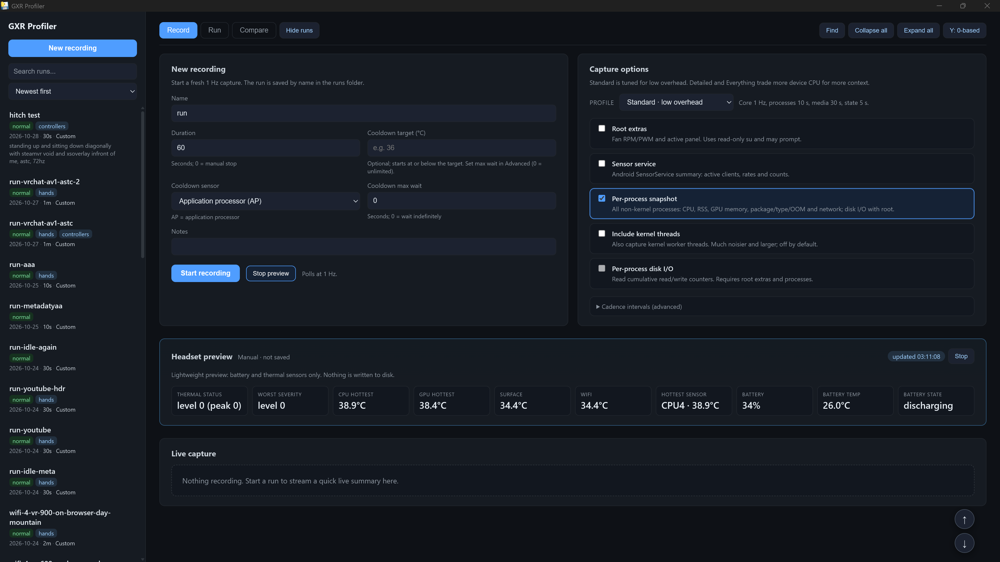
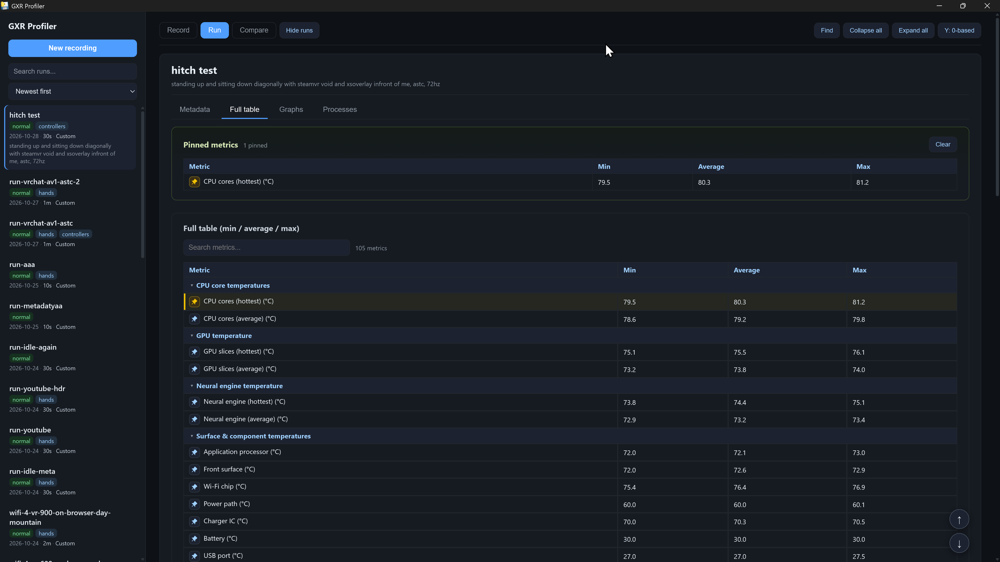
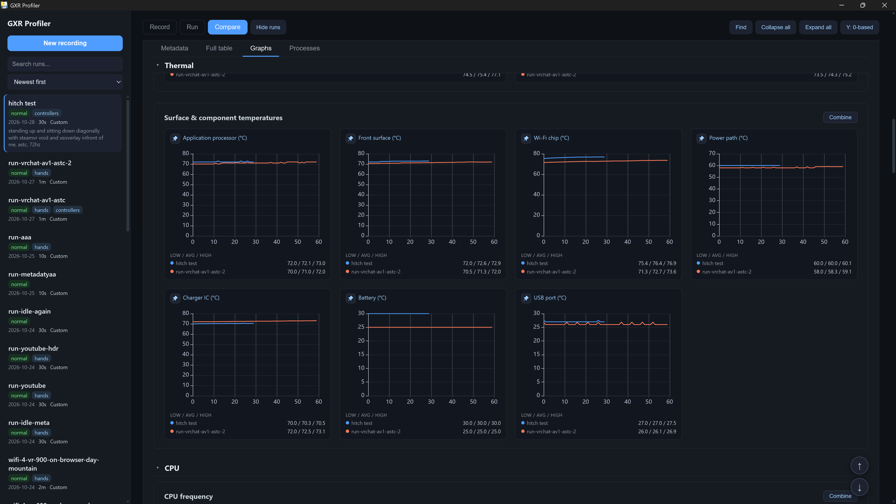
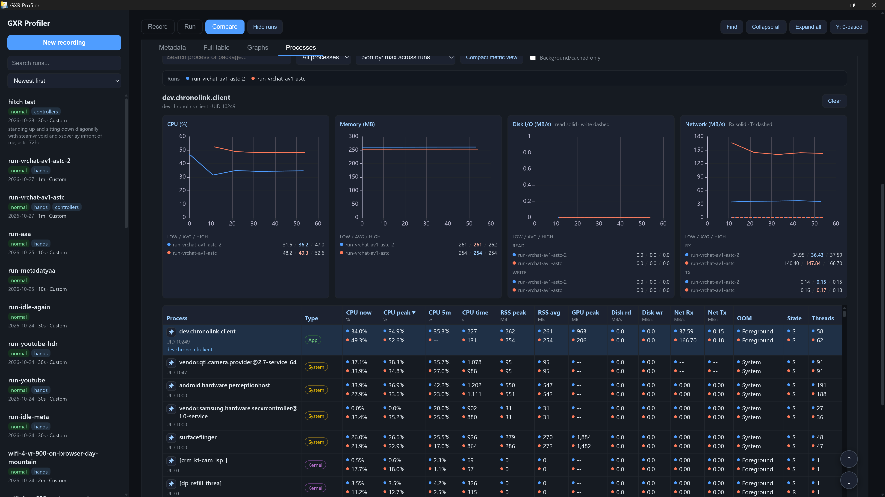
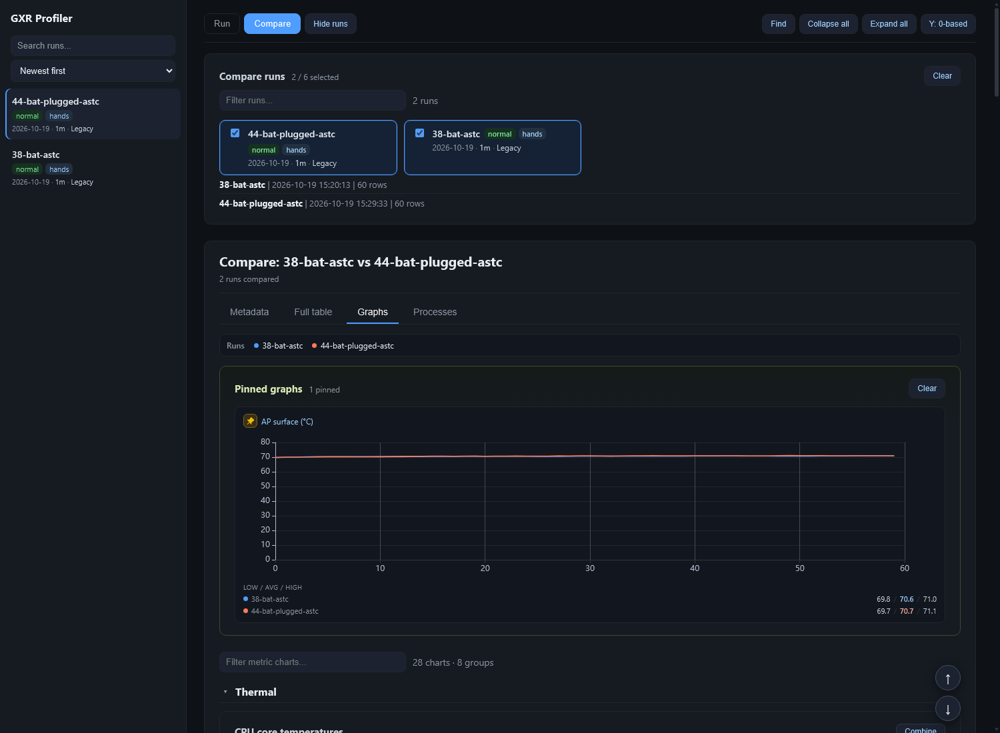

# GXR Profiler

Read-only thermal / performance profiler for a **Samsung Galaxy XR (SM-I610)** over wireless ADB.
Record a run, then explore or compare runs in a local web app (native window or browser) or a
self-contained HTML report. Built for before/after thermal-mod benchmarking.

NOTE: Written with heavy LLM assistance - this grew in size way beyond what I originally had in mind.

Everything it sends to the headset is a read: `cat`, `getprop`, `dumpsys`, `cmd wifi status`,
`logcat`, `ps`. Nothing is written to the device.

## Features

- Read-only 1 Hz recording over wireless ADB.
- Thermal, CPU/GPU/NPU, fan, XR, display, battery, memory, storage, network, media/audio and controller telemetry.
- Lightweight headset preview without saving a run.
- Run and compare views with tables, overlaid graphs and per-process timelines.
- Session-wide pinned metrics/processes plus lowest/highest-average highlighting.
- Self-contained HTML export with common Wi-Fi/device identifiers redacted.
- Optional root extras for fan RPM/PWM, active panel, calibration and per-process disk I/O.

## Screenshots



<details>
<summary>More screenshots</summary>

**Full table**



**Compare: graphs**



**Compare: processes**



**Offline HTML export**



</details>

## Requirements

- Windows 10/11
- `adb` on PATH (or set `ADB`)
- Headset paired over wireless ADB
- Microsoft Edge WebView2 runtime for the native window (included with current Win10/Win11)
- **No Python installation is needed for the packaged `.exe`**

Building from source or running the CLI from Python requires Python 3.11+; see
[development setup](docs/DEVELOPMENT.md).

## Quick start

1. Download `gxr-profiler.exe` from the GitHub releases.
2. Pair and connect the headset using the IP address and ports shown in its wireless-debugging
   settings:

   ```powershell
   adb pair <headset-ip:pair-port> <pairing-code>
   adb connect <headset-ip:connect-port>
   adb devices
   ```

3. Put the exe in a writable folder and double-click it. No `--serial` is needed once a single
   headset is paired.
4. On **Record**, set the duration/options and press **Start recording**. The **Preview headset**
   button reads battery and thermal values without saving a run.
5. Open **Run** for the results, or select runs in **Compare** to overlay and compare them.
6. Use **Export HTML** from Run or Compare to save a self-contained, shareable report with no
   internet or Python required.

`runs/` and `reports/` are created next to the exe. Keep the exe folder writable, and do not share
the raw `runs/` folder unless you have checked its contents; exported HTML redacts common
network/device identifiers.

CLI users: see [docs/CLI.md](docs/CLI.md).

### Supported device

**Samsung Galaxy XR (SM-I610) is the only tested and supported target.** Other Android XR devices
may start, but Samsung-specific thermal, fan, panel and XR telemetry will largely be missing.
Details: [device support](docs/README.md#device-support).

## Build & releases

Releases contain two one-file Windows executables:

- `gxr-profiler.exe` - windowed GUI
- `gxr-profiler-cli.exe` - terminal/CLI build

The GUI needs `adb` and WebView2. It does not need Python. For source setup, architecture, tests,
packaging and the GitHub release workflow, see [docs/DEVELOPMENT.md](docs/DEVELOPMENT.md).

## Documentation

- [Detailed guide: capture, output/schema and safety](docs/README.md)
- [CLI reference](docs/CLI.md)
- [Development, tests and packaging](docs/DEVELOPMENT.md)
- [Every headset command and polling cadence](docs/COMMANDS.md)
- [Personal research notes and measurement findings directory](docs/findings/)

## Safety

- Every headset command is read-only; nothing persists on the device.
- `--root` only performs read-only `su -c` reads and may trigger a root prompt.
- Exported HTML redacts Wi-Fi SSID/BSSID/IP and serial fields; raw run files keep the original
  values.

For detailed safety notes and fair-run guidance, see
[safety & fair runs](docs/README.md#safety--fair-runs).
