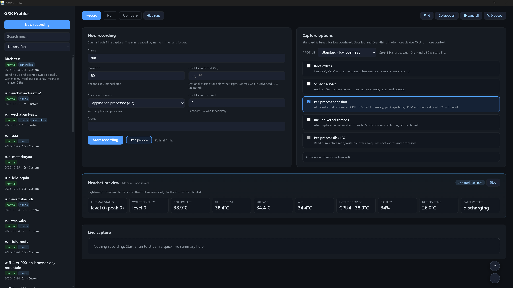
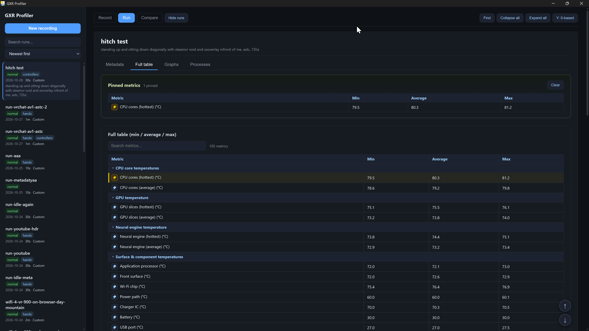
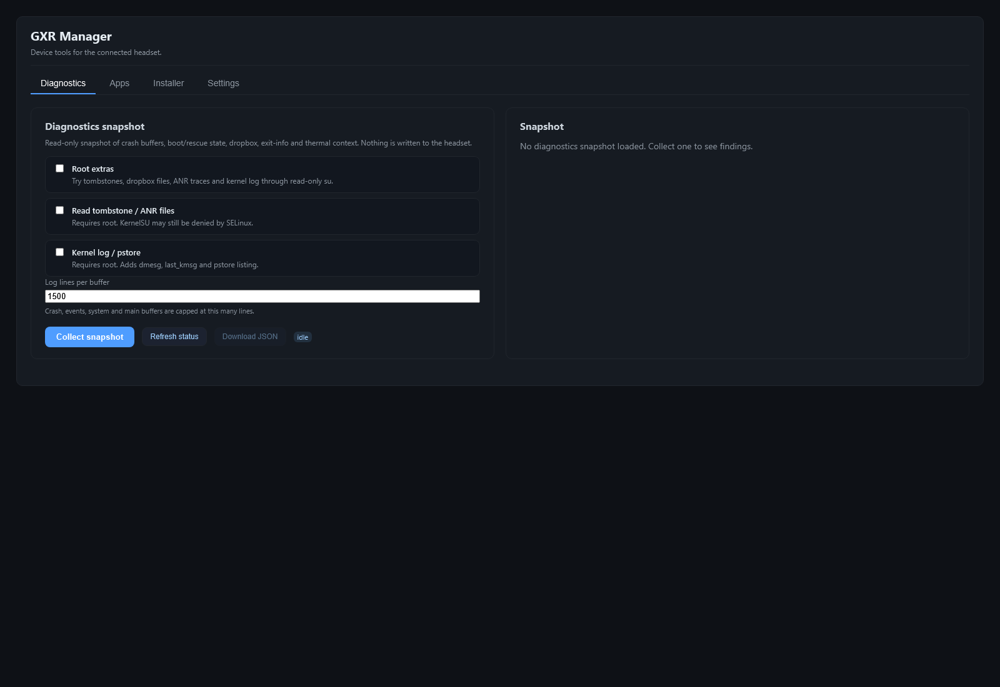
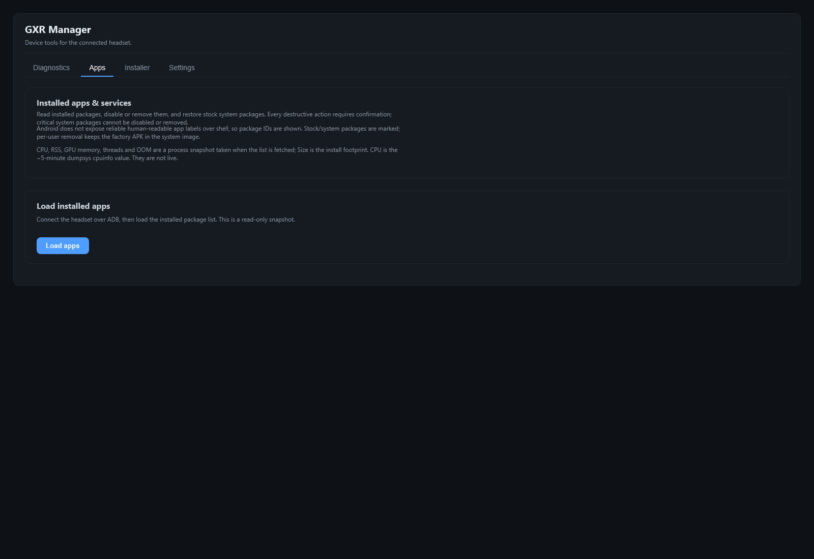
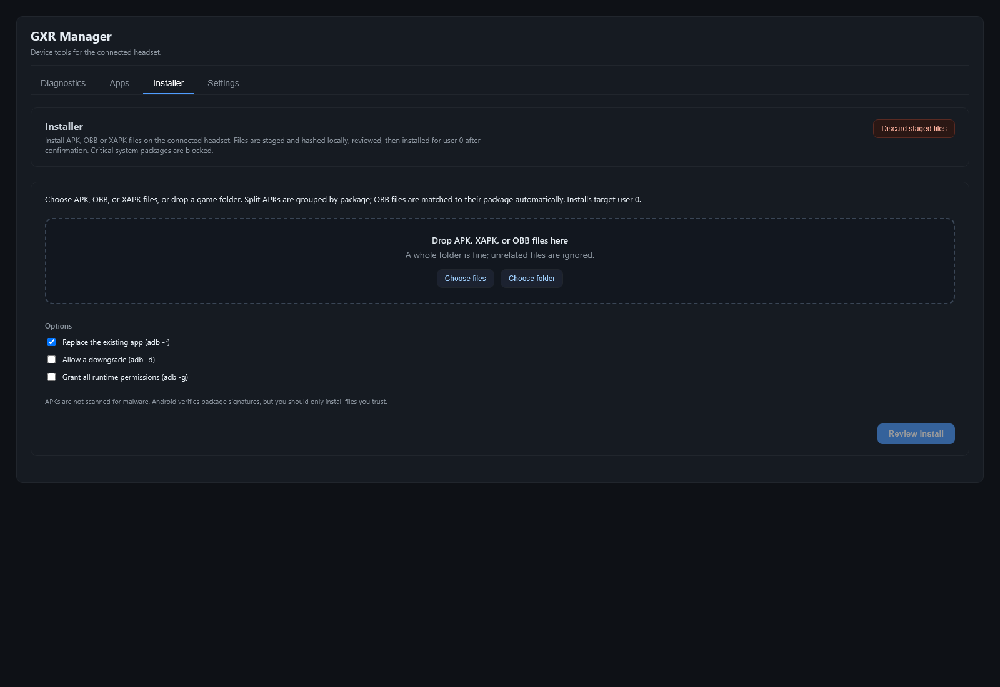
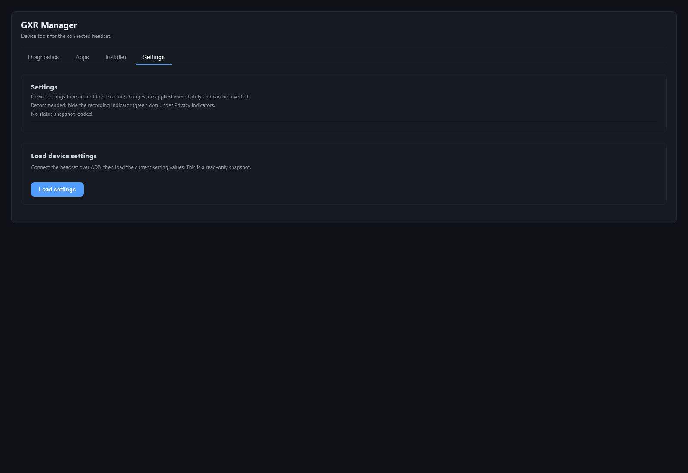

# GXR Tools

Two local Windows apps for a **Samsung Galaxy XR (SM-I610)** over wireless ADB:

| App | Executable | Use it to | Changes the headset? |
|---|---|---|---|
| **GXR Profiler** | `gxr-profiler.exe` | Record a run, preview telemetry, compare runs and export HTML reports. | No |
| **GXR Manager** | `gxr-manager.exe` | Collect Diagnostics, manage Apps, install packages and change Settings. | Only after explicit confirmation |

Each app also ships a terminal build: `gxr-profiler-cli.exe` and `gxr-manager-cli.exe`.

NOTE: Written with heavy LLM assistance - this grew in size way beyond what I originally had in mind.

Keep both executables in the same folder so the recording lock is shared. While GXR Profiler records,
GXR Manager blocks every device-changing action.

## Features

### GXR Profiler

- Read-only 1 Hz recording over wireless ADB.
- Thermal, CPU/GPU/NPU, fan, XR, display, battery, power rail, memory, storage, network, media/audio and controller telemetry.
- Lightweight headset preview without saving a run.
- Run and compare views with tables, overlaid graphs and per-process timelines, plus All/CPU/GPU/Extra section sub-tabs for graphs and tables.
- Session-wide pinned metrics/processes plus lowest/highest-average highlighting.
- Self-contained HTML export with common Wi-Fi/device identifiers redacted.
- Optional root extras for fan RPM/PWM, active panel, calibration, per-process disk I/O and app data/cache size.

### GXR Manager

- **Diagnostics** - one-click crash, boot/rescue, Dropbox, exit-info and thermal snapshot; saves JSON + Markdown under `reports/debug/`.
- **Apps** - list installed apps/system packages with sortable one-shot process CPU/RSS/GPU/threads, OOM and install-size columns; inspect metadata; disable, enable, remove for user 0, restore or fully uninstall after confirmation; apply Game Mode FPS/render-scale overrides on supported titles. Critical system packages are protected.
- **Installer** - stage and install APK, OBB and XAPK files after a command review and confirmation. Groups split APKs by package, infers OBB targets, verifies installed packages and pushed files, and logs each install with file hashes.
- **Settings** - grouped, reversible device settings: XR performance metrics, hands breakthrough, touch input, guardian/boundary controls, auto-spatialization, animation/transparency tweaks, testing-only performance policy, child-process, stay-awake and heads-up controls, plus Game Optimizing Service. Each row labels persistence and warns about burn-in, safety or untested behavior.

## Screenshots

### GXR Profiler



<details>
<summary>More GXR Profiler screenshots</summary>

**Full table**



**Compare: graphs**


**Compare: processes**


**Offline HTML export**


</details>

### GXR Manager



<details>
<summary>More GXR Manager screenshots</summary>

**Apps**



**Installer**



**Settings**



</details>

## Requirements

- Windows 10/11
- `adb` on PATH, set via `ADB`, or placed next to either executable (a `platform-tools` subfolder also works)
- Headset paired over wireless ADB
- Microsoft Edge WebView2 runtime for the native windows (included with current Win10/Win11)
- **No Python installation is needed for the packaged `.exe` files**

Building from source or running either CLI from Python requires Python 3.11+; see [development setup](docs/DEVELOPMENT.md).

## Quick start

1. Download the two GUI executables (`gxr-profiler.exe` and `gxr-manager.exe`) from the GitHub releases. The release also includes `gxr-profiler-cli.exe` and `gxr-manager-cli.exe`.
2. Pair and connect the headset using the IP address and ports shown in its wireless-debugging settings:

   ```powershell
   adb pair <headset-ip:pair-port> <pairing-code>
   adb connect <headset-ip:connect-port>
   adb devices
   ```

3. Put both executables in the same writable folder. No `--serial` is needed once a single headset is paired.

### Record a run

1. Open **GXR Profiler**.
2. On **Record**, set the duration and options, then press **Start recording**. **Preview headset** reads battery, thermal, power, Wi-Fi and fan-step values without saving a run.
3. If wireless ADB is still reconnecting, the first Preview/Start waits and retries for up to 30 seconds before reporting an error.
4. Open **Run** for results, or select runs in **Compare** to overlay them.
5. Use **Export HTML** to save a self-contained report with no internet or Python required.

### Inspect or change the headset

1. Open **GXR Manager**.
2. Use **Diagnostics** after a crash or unexpected restart.
3. Use **Apps** to inspect, disable, remove, restore or uninstall packages, and to apply Game Mode overrides.
4. Use **Installer** to stage APK/OBB/XAPK files, review the exact commands, then confirm.
5. Use **Settings** to change reversible device settings.

`runs/` and `reports/` are created next to the profiler executable. Manager logs and staging live
next to the manager executable; keeping both together also shares the recording lock. Keep the folder
writable, and do not share the raw `runs/` folder unless you have checked its contents; exported HTML
redacts common network/device identifiers.

The profiler UI uses port **8765** and the manager uses **8766** by default; each moves to the next
free port if taken. Both can run at once, but the manager blocks device changes while the profiler is
recording.

## Supported device

**Samsung Galaxy XR (SM-I610) is the only tested and supported target.** Other Android XR devices may
start, but Samsung-specific thermal, fan, panel and XR telemetry will largely be missing. Details:
[device support](docs/PROFILER.md#device-support).

## Build & releases

GXR Tools releases contain four one-file Windows executables:

- `gxr-profiler.exe` - profiler windowed GUI
- `gxr-profiler-cli.exe` - profiler terminal/CLI build
- `gxr-manager.exe` - manager windowed GUI
- `gxr-manager-cli.exe` - manager terminal/CLI build

The GUIs need `adb` and WebView2. They do not need Python. For source setup, architecture, tests,
packaging and the GitHub release workflow, see [docs/DEVELOPMENT.md](docs/DEVELOPMENT.md).

## Documentation

### GXR Profiler

- [Profiler guide: capture, output, schema and safety](docs/PROFILER.md)
- [CLI reference](docs/CLI.md#gxr-profiler-cli)
- [Capture commands and polling cadence](docs/COMMANDS.md)
- [Research & findings hub](docs/gxr-findings/README.md)

### GXR Manager

- [Manager guide](docs/MANAGER.md)
- [Diagnostics guide](docs/DIAGNOSTICS.md)
- [Apps, installer & services guide](docs/APPS.md)
- [Settings guide](docs/SETTINGS.md)
- [Hidden and experimental ADB settings](docs/HIDDEN_ADB_SETTINGS.md)

### Shared

- [Documentation home](docs/README.md)
- [Development, tests and packaging](docs/DEVELOPMENT.md)

## Safety

| App | Device access |
|---|---|
| **GXR Profiler** | Read-only. Recording, preview and report export use `cat`, `getprop`, `dumpsys`, `logcat` and `ps`. `--root` adds read-only `su -c` reads and may prompt. |
| **GXR Manager** | Device-changing, but only after an explicit confirmation in the local UI and with the local API token. Actions are blocked while the profiler records and logged under `reports/apps/` and `reports/settings/`. |

Full details: [profiler safety & fair runs](docs/PROFILER.md#safety--fair-runs) and
[manager device-change safety](docs/MANAGER.md#device-change-safety).

Exported HTML redacts Wi-Fi SSID/BSSID/IP and serial fields; raw run files keep the original values.
