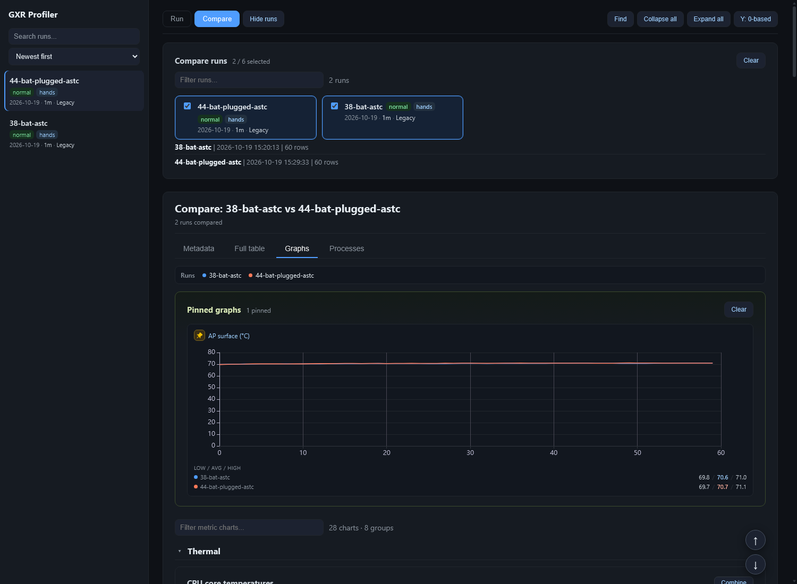

# GXR Profiler

Thermal / performance profiler for a **Samsung Galaxy XR (SM-I610)** over wireless ADB. Record a run, then explore or compare runs in a local web app (native window or browser) or a self-contained HTML report. Built for before/after thermal-mod benchmarking.

NOTE: Written with heavy LLM assistance - this grew in size way beyond what I originally had in mind.

Recording, preview, diagnostics and exports are read-only. `Tools > Apps` is the one optional package-management workflow; it only changes the headset after an explicit, confirmed action.

## Features

- Read-only 1 Hz recording over wireless ADB.
- Thermal, CPU/GPU/NPU, fan, XR, display, battery, power rail, memory, storage, network, media/audio and controller telemetry.
- Lightweight headset preview without saving a run.
- Run and compare views with tables, overlaid graphs and per-process timelines, plus All/CPU/GPU/Extra section sub-tabs for graphs and tables.
- Session-wide pinned metrics/processes plus lowest/highest-average highlighting.
- Self-contained HTML export with common Wi-Fi/device identifiers redacted.
- One-click **Tools > Diagnostics** snapshot for crash buffers, boot/rescue state, Dropbox, exit-info and thermal context; saves JSON + Markdown under `reports/debug/`.
- **Tools > Apps** package manager: list installed apps/system packages with sortable one-shot process CPU/RSS/GPU/threads, OOM and install-size columns, see metadata and state, disable/enable, remove non-critical stock packages for user 0, restore them, or fully uninstall user apps after confirmation. Critical system packages are protected from disable/remove.
- Optional root extras for fan RPM/PWM, active panel, calibration, per-process disk I/O and app data/cache size.

## Screenshots


<details>
<summary>More screenshots</summary>

**Full table**


**Compare: graphs**


**Compare: processes**


**Offline HTML export**



</details>

## Requirements

- Windows 10/11
- `adb` on PATH, set via `ADB`, or placed next to `gxr-profiler.exe` (a `platform-tools` subfolder also works)
- Headset paired over wireless ADB
- Microsoft Edge WebView2 runtime for the native window (included with current Win10/Win11)
- **No Python installation is needed for the packaged `.exe`**

Building from source or running the CLI from Python requires Python 3.11+; see [development setup](docs/DEVELOPMENT.md).

## Quick start

1. Download `gxr-profiler.exe` from the GitHub releases.
2. Pair and connect the headset using the IP address and ports shown in its wireless-debugging settings:

   ```powershell
   adb pair <headset-ip:pair-port> <pairing-code>
   adb connect <headset-ip:connect-port>
   adb devices
   ```

3. Put the exe in a writable folder and double-click it. No `--serial` is needed once a single headset is paired.
4. On **Record**, set the duration/options and press **Start recording**. The **Preview headset** button reads battery, thermal, power, Wi-Fi and fan-step values without saving a run. If wireless ADB is still reconnecting, the first Preview/Start waits and retries for up to 30 seconds before reporting an error.
5. Open **Run** for the results, or select runs in **Compare** to overlay and compare them.
6. Open **Tools > Diagnostics** for a one-click crash/soft-reboot snapshot (JSON + Markdown under `reports/debug/`), or **Tools > Apps** to inspect and manage installed packages.
7. Use **Export HTML** from Run or Compare to save a self-contained, shareable report with no internet or Python required.

`runs/` and `reports/` are created next to the exe. Keep the exe folder writable, and do not share the raw `runs/` folder unless you have checked its contents; exported HTML redacts common network/device identifiers.

The local UI uses port **8765** by default and automatically moves to the next free port if it is already taken. This lets GXR Profiler and Desktop Profiler run side by side.

CLI users: see [docs/CLI.md](docs/CLI.md).

### Supported device

**Samsung Galaxy XR (SM-I610) is the only tested and supported target.** Other Android XR devices may start, but Samsung-specific thermal, fan, panel and XR telemetry will largely be missing. Details: [device support](docs/README.md#device-support).

## Build & releases

Releases contain two one-file Windows executables:

- `gxr-profiler.exe` - windowed GUI
- `gxr-profiler-cli.exe` - terminal/CLI build

The GUI needs `adb` and WebView2. It does not need Python. For source setup, architecture, tests, packaging and the GitHub release workflow, see [docs/DEVELOPMENT.md](docs/DEVELOPMENT.md).

## Documentation

- [Detailed guide: capture, output/schema and safety](docs/README.md)
- [Diagnostics guide](docs/DIAGNOSTICS.md)
- [Apps & services guide](docs/APPS.md)
- [CLI reference](docs/CLI.md)
- [Development, tests and packaging](docs/DEVELOPMENT.md)
- [Every headset command and polling cadence](docs/COMMANDS.md)
- [Personal research notes and measurement findings directory](docs/gxr-findings/)

Findings pages label their hardware state: **stock/unmodified before 2026-11-01**, **SoC thermal-modded from 2026-11-01 onward** (phase-change pads + copper shims). Thermal status 4 was only observed on the stock unit.

## Safety

- Recording, preview, diagnostics and report export are read-only; nothing persists on the device.
- `Tools > Apps` can disable, remove for user 0, restore or uninstall packages. It only runs after an explicit confirmation in the local UI, requires the local API token, and logs actions under `reports/apps/`. Non-critical stock packages are removed for user 0 only; the system image is never edited. Critical packages cannot be disabled or removed.
- `--root` performs read-only `su -c` reads and may trigger a root prompt. App data/cache size is the optional root detail in the Apps tool.
- Exported HTML redacts Wi-Fi SSID/BSSID/IP and serial fields; raw run files keep the original values.

For detailed safety notes and fair-run guidance, see [safety & fair runs](docs/README.md#safety--fair-runs).


