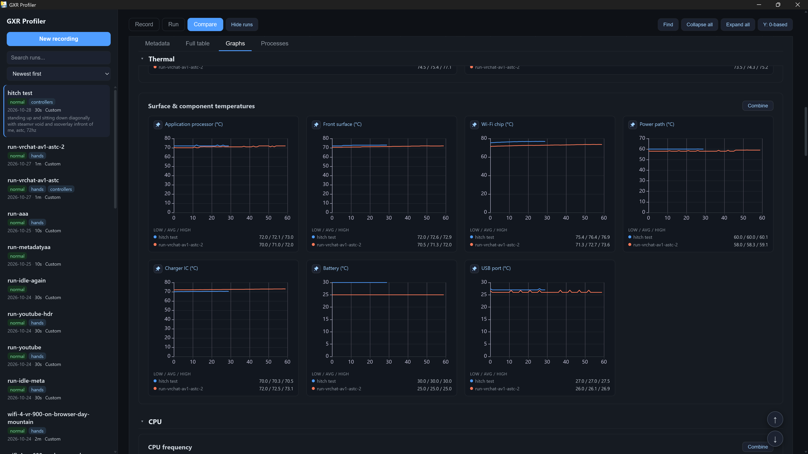
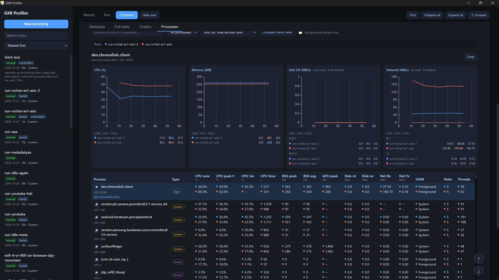

# GXR Profiler

Thermal / performance profiler for a **Samsung Galaxy XR (SM-I610)** over wireless ADB. Record a run, then explore or compare runs in a local web app (native window or browser) or a self-contained HTML report. Built for before/after thermal-mod benchmarking.

NOTE: Written with heavy LLM assistance - this grew in size way beyond what I originally had in mind.

Recording, preview and exports are read-only. The separate **GXR Manager** app provides Diagnostics, Apps, Installer and Settings, it only changes the headset after an explicit action. Keep both executables in the same folder so the recording lock is shared.

## Features

- Read-only 1 Hz recording over wireless ADB.
- Thermal, CPU/GPU/NPU, fan, XR, display, battery, power rail, memory, storage, network, media/audio and controller telemetry.
- Lightweight headset preview without saving a run.
- Run and compare views with tables, overlaid graphs and per-process timelines, plus All/CPU/GPU/Extra section sub-tabs for graphs and tables.
- Session-wide pinned metrics/processes plus lowest/highest-average highlighting.
- Self-contained HTML export with common Wi-Fi/device identifiers redacted.
- One-click **GXR Manager > Diagnostics** snapshot for crash buffers, boot/rescue state, Dropbox, exit-info and thermal context; saves JSON + Markdown under `reports/debug/`.
- **GXR Manager > Apps** package manager: list installed apps/system packages with sortable one-shot process CPU/RSS/GPU/threads, OOM and install-size columns, see metadata and state, disable/enable, remove non-critical stock packages for user 0, restore them, fully uninstall user apps after confirmation, and apply per-app Game Mode FPS/render-scale overrides on supported titles. Critical system packages are protected from disable/remove and performance overrides.
- **GXR Manager > Installer** stages and installs APK, OBB and XAPK files after a command review and confirmation. It groups split APKs by package, infers OBB targets, verifies installed packages and pushed files, and logs each install with file hashes. Critical packages cannot be installed over.
- **GXR Manager > Settings** reversible device settings, including XR performance metrics, hands breakthrough, touch input, guardian/boundary controls, auto-spatialization, animation/transparency tweaks, testing-only performance-policy, child-process, stay-awake and heads-up controls, and Game Optimizing Service, plus testing-only firmware keys. Each row labels whether it survives reboots and warns about burn-in, safety or untested behavior.
- Optional root extras for fan RPM/PWM, active panel, calibration, per-process disk I/O and app data/cache size.

## Screenshots


<details>
<summary>More screenshots</summary>

**Full table**


**Compare: graphs**



**Compare: processes**



**Offline HTML export**


</details>

## Requirements

- Windows 10/11
- `adb` on PATH, set via `ADB`, or placed next to `gxr-profiler.exe` (a `platform-tools` subfolder also works)
- Headset paired over wireless ADB
- Microsoft Edge WebView2 runtime for the native window (included with current Win10/Win11)
- **No Python installation is needed for the packaged `.exe`**

Building from source or running the CLI from Python requires Python 3.11+; see [development setup](docs/DEVELOPMENT.md).

## Quick start

1. Download the two GUI executables (`gxr-profiler.exe` and `gxr-manager.exe`) from the GitHub releases. The release also includes `gxr-profiler-cli.exe` and `gxr-manager-cli.exe`.
2. Pair and connect the headset using the IP address and ports shown in its wireless-debugging settings:

   ```powershell
   adb pair <headset-ip:pair-port> <pairing-code>
   adb connect <headset-ip:connect-port>
   adb devices
   ```

3. Put both exes in the same writable folder and double-click the one you need. No `--serial` is needed once a single headset is paired.
4. On **Record**, set the duration/options and press **Start recording**. The **Preview headset** button reads battery, thermal, power, Wi-Fi and fan-step values without saving a run. If wireless ADB is still reconnecting, the first Preview/Start waits and retries for up to 30 seconds before reporting an error.
5. Open **Run** for the results, or select runs in **Compare** to overlay and compare them.
6. Open the **GXR Manager** exe for Diagnostics, Apps, Installer and Settings. The profiler remains focused on recording and analysis.
7. Use **Export HTML** from Run or Compare to save a self-contained, shareable report with no internet or Python required.

`runs/` and `reports/` are created next to the profiler exe. Manager logs and staging live next to the manager exe; keeping both exes together also shares the recording lock. Keep the exe folder writable, and do not share the raw `runs/` folder unless you have checked its contents; exported HTML redacts common network/device identifiers.

The profiler UI uses port **8765** and the manager uses **8766** by default; each moves to the next free port if taken. Both can run at once, but the manager blocks device changes while the profiler is recording.

CLI users: see [docs/CLI.md](docs/CLI.md).

### Supported device

**Samsung Galaxy XR (SM-I610) is the only tested and supported target.** Other Android XR devices may start, but Samsung-specific thermal, fan, panel and XR telemetry will largely be missing. Details: [device support](docs/README.md#device-support).

## Build & releases

Releases contain four one-file Windows executables:

- `gxr-profiler.exe` - profiler windowed GUI
- `gxr-profiler-cli.exe` - profiler terminal/CLI build
- `gxr-manager.exe` - device-tools windowed GUI
- `gxr-manager-cli.exe` - device-tools terminal/CLI build

The GUIs need `adb` and WebView2. They do not need Python. For source setup, architecture, tests, packaging and the GitHub release workflow, see [docs/DEVELOPMENT.md](docs/DEVELOPMENT.md).

## Documentation

- [Capture, output, schema and safety](docs/README.md)
- [GXR Manager guide](docs/MANAGER.md)
- [Diagnostics guide](docs/DIAGNOSTICS.md)
- [Apps, installer & services guide](docs/APPS.md)
- [Settings guide](docs/SETTINGS.md)
- [Hidden and experimental ADB settings](docs/HIDDEN_ADB_SETTINGS.md)
- [CLI reference](docs/CLI.md)
- [Development, tests and packaging](docs/DEVELOPMENT.md)
- [Capture commands and polling cadence](docs/COMMANDS.md)
- [Research & findings hub](docs/gxr-findings/README.md)

Findings pages label their hardware state: **stock/unmodified before 2026-11-01**, **SoC thermal-modded from 2026-11-01 onward** (phase-change pads + copper shims). Thermal status 4 was only observed on the stock unit.

## Safety

- Recording, preview and report export are read-only; nothing persists on the device.
- `GXR Manager > Apps` can disable, remove for user 0, restore, uninstall packages, or apply Game Mode FPS/render-scale overrides on supported titles. It only runs after an explicit confirmation in the local UI, requires the local API token, and logs actions under `reports/apps/`. Non-critical stock packages are removed for user 0 only; the system image is never edited.
- `GXR Manager > Installer` can install APK/OBB/XAPK files. Installs are staged locally, hashed, reviewed and sent to user 0 after confirmation; the API token is required and each run is logged under `reports/apps/`. Critical packages cannot be installed over, and installs are blocked during recording.
- `GXR Manager > Settings` can change reversible device settings, including XR controls, display/UI keys, update packages and optional advanced/testing keys. Changes are blocked during recording and logged under `reports/settings/`. The performance overlay warns about OLED burn-in; disabling the guardian boundary requires confirmation. Some testing-only keys have unverified behavior or numeric mappings.
- `--root` performs read-only `su -c` reads and may trigger a root prompt. App data/cache size is the optional root detail in GXR Manager > Apps.
- Exported HTML redacts Wi-Fi SSID/BSSID/IP and serial fields; raw run files keep the original values.

For detailed safety notes and fair-run guidance, see [safety & fair runs](docs/README.md#safety--fair-runs).
